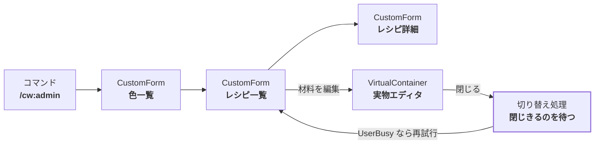

# 管理画面とレシピエディタ

文字・数値・トグルの入力は CustomForm（DDUI）、アイテムの登録と確認は VirtualContainer が担当する。フォームはアイテムを表示できず、コンテナは文字を入力できないため。

| 画面                       | 担当                                                                                 |
| -------------------------- | ------------------------------------------------------------------------------------ |
| CustomForm：色一覧         | 16色の設定状況（表示名・レシピ数）を一覧表示                                         |
| CustomForm：色の設定       | 表示名、グリッドサイズ、使用に必要なタグ、レシピ一覧（名前で表示）                   |
| CustomForm：レシピの詳細   | 形状（固定／不定）、照合モード、コスト、条件、報酬コマンド。削除は MessageBox で確認 |
| VirtualContainer：エディタ | 材料と完成品を実物で置いて登録・編集する                                             |

- CustomForm はボタンの callback がフォームを開いたまま実行され、Observable を更新すると表示もその場で変わる。削除やトグルの結果が画面を閉じずに反映される
- `visible` / `disabled` に Observable を渡し、上級者向けの設定は折りたたんでおく
- エディタはクラフト画面と同じレイアウトを使い、完成品スロットにも自由に置けるようにする。配置したアイテムは名前・説明文・エンチャントごと取り込む
- エディタを閉じたら、置いたアイテムは管理者に返す（登録しただけでアイテムを失わない）
- DDUI のフォームも VirtualContainer も、他の UI を開いていると表示できない。切り替えは「前の画面が閉じきってから次を開く」処理を1か所にまとめる（次節）

## 画面遷移

エディタから戻るときは、画面が閉じきってから次を開く。

フォームとエディタは同時に表示できないため、`virtualContainerClose` を受けてから次のフォームを `show()` し、結果が `UserBusy` なら数 tick 後に再試行する。`/cw:admin <色>` で始めた場合はレシピ一覧から開く。
