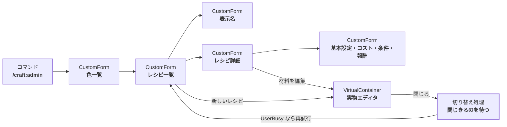

# 管理画面とレシピエディタ

文字・数値・トグルの入力は CustomForm（DDUI）、アイテムの登録と確認は VirtualContainer が担当する。フォームはアイテムを表示できず、コンテナは文字を入力できないため。

| 画面                       | 担当                                                                                                             |
| -------------------------- | ---------------------------------------------------------------------------------------------------------------- |
| CustomForm：色一覧         | 16色の設定状況（表示名・レシピ数）を一覧表示                                                                     |
| CustomForm：色の設定       | 設定項目（表示名など）のボタンと、レシピ一覧（名前で表示）                                                       |
| CustomForm：レシピの詳細   | 項目ごとのボタン（基本設定・コスト・条件・報酬・材料と完成品）に今の設定を添えて並べる。削除は MessageBox で確認 |
| CustomForm：項目ごとの設定 | 基本設定（名前・形状・照合モード）、コスト、条件、報酬コマンドを、それぞれ別のフォームで編集する                 |
| VirtualContainer：エディタ | 材料と完成品を実物で置いて登録・編集する                                                                         |

- 1つのフォームに設定を詰め込まない。入力欄が多いとスクロールが増えて使いにくいため、詳細画面は「項目ごとのボタン＋今の設定の要約」にし、入力は項目ごとの小さなフォームで行う。項目が増えてもボタンを足すだけで済む
- 項目ごとのフォームは「保存して戻る」と「戻る」だけを持ち、どちらも詳細画面に戻る。詳細画面は開き直すので、要約は保存した値で表示される
- エディタはクラフト画面と同じレイアウトを使い、完成品スロットにも自由に置けるようにする。配置したアイテムは名前・説明文・エンチャントごと取り込む
- エディタを閉じたら、置いたアイテムは管理者に返す（登録しただけでアイテムを失わない）
- DDUI のフォームも VirtualContainer も、他の UI を開いていると表示できない。表示できなかった（`UserBusy`）ときは数 tick 後に再試行する（次節）
- フォームからフォームへは、ボタンの callback で `form.close()` してすぐ次を `show()` してよい（実機で確認）。`uiManager.closeAllForms()` はCustomFormを閉じない。

## 画面遷移

エディタから戻るときは、画面が閉じきってから次を開く。

フォームとエディタは同時に表示できないため、`virtualContainerClose` を受けてから次のフォームを `show()` し、結果が `UserBusy` なら数 tick 後に再試行する。`/craft:admin <色>` で始めた場合はレシピ一覧から開く。
